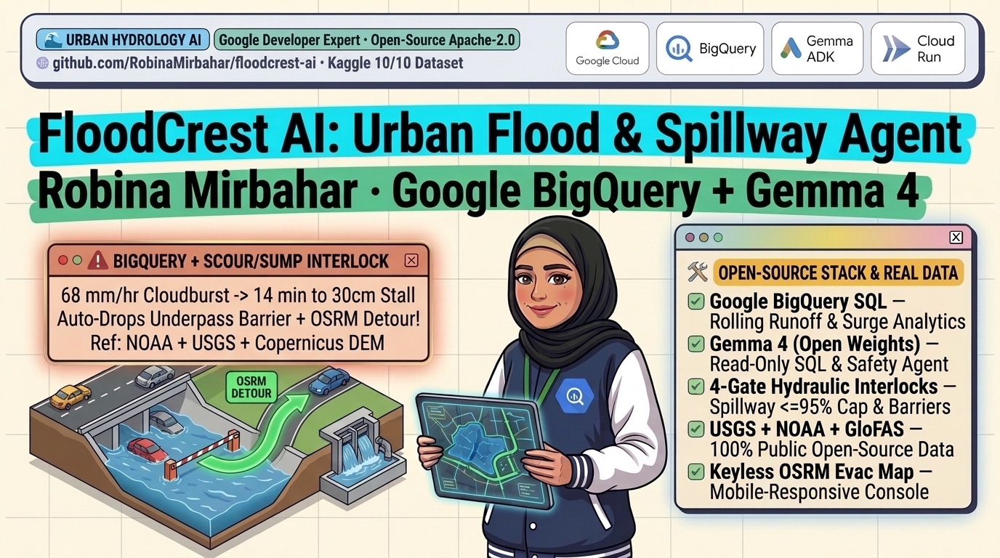

**Author:** Robina Mirbahar  
*AI/ML Google Developer Expert (GDE) | Google Cloud Champion Innovator | WTM Ambassador*  

- **GitHub Open-Source Repo:** [github.com/RobinaMirbahar/floodcrest-ai](https://github.com/RobinaMirbahar/floodcrest-ai)
- **Kaggle Multi-Scale Hydrology Dataset (3,081 Records):** [FloodCrest Urban Flash-Flood & Spillway Data](https://www.kaggle.com/datasets/robinamirbahar/floodcrest-global-urban-flash-flood-spillway)
- **Kaggle 4-Figure Analytical Study Notebook:** [FloodCrest AI: BigQuery & Gemma 4 Hydrology Study](https://www.kaggle.com/code/robinamirbahar/floodcrest-ai-bigquery-gemma-4-hydrology-study)

---

During severe urban cloudbursts in Houston, New York, Karachi, Lahore, Dubai, London, Baku, and Seoul, depressed highway underpasses and commuter tunnels flood to life-threatening depths long before main regional rivers ever crest.

Just **`0.30 m` (`30 cm` / `12 inches`)** of standing water stalls passenger-car engines and begins floating sedans. Yet every monsoon and convective storm season, drivers enter sunken underpasses while automated flood alerts remain silent.

When I reviewed **2024 to 2025 peer-reviewed urban hydrology and AI flood-control literature**, three concrete research gaps explained why both traditional river models and raw LLM agents fail during cloudbursts:

1. **The Catchment-to-Underpass Scale Mismatch:** Regional flood forecasting models (such as `5 km` [Copernicus GloFAS](https://open-meteo.com/en/docs/flood-api) grids) smooth out urban micro-topography. Sunken roadway sumps sit `4.8 m` to `5.2 m` below surrounding grade, concentrating impervious sheet runoff (`C = 0.84 to 0.92`) to `30 cm` stall depth in **12 to 20 minutes**.
2. **Pluvial-Fluvial "Double-Peak" Lag Variance:** Urban pluvial flash flooding hits its lethal peak hours before the broader fluvial river wave arrives at downstream gauges.
3. **Paradoxical Detention-Spillway Channel Surcharging:** When upstream stormwater detention basins exceed `85%` fill, unconstrained AI/LLM supervisory agents routinely command emergency spillway releases without checking downstream river conveyance headroom, surcharging bankfull channels and flooding downstream neighborhoods.

To close this multi-scale gap, I built and open-sourced **FloodCrest AI**, an urban flash-flood, drop-arm barrier, and spillway safety platform powered by [Google BigQuery StandardSQL](https://cloud.google.com/bigquery/docs), [Google Gemma 4 (open weights)](https://ai.google.dev/gemma/docs), **4 deterministic hydraulic safety interlocks**, and keyless [OSRM](https://project-osrm.org/docs/v5.24.0/api/) high-ground evacuation routing.



---

## System Architecture: Google BigQuery Warehouse + Gemma 4 + 4 Hydraulic Hard Gates

In safety-critical hydrology, **BigQuery** aggregates multi-horizon sensor history, **Gemma 4** orchestrates read-only analytical SQL and explains basin risk, and **deterministic Python physics gates** hold final authority over road barriers and spillway actuators:

```plaintext
┌────────────────────────────────────────────────────────────────────────┐
│         Multi-Scale Public Hydrology & Elevation Data Streams          │
│  USGS 15-min Gauges • NOAA GSOD • Copernicus 90m DEM • GloFAS • OSRM   │
└───────────────────────────────────┬────────────────────────────────────┘
                                    │
                                    ▼
┌────────────────────────────────────────────────────────────────────────┐
│       Google BigQuery StandardSQL Warehouse (Read-Only Guardrail)      │
│  • Blocks all DDL/DML mutations via AST token verification             │
│  • Computes 45d GloFAS channel utilization & 15-min USGS stage surges  │
└───────────────────────────────────┬────────────────────────────────────┘
                                    │
                                    ▼
┌────────────────────────────────────────────────────────────────────────┐
│      Open-Weights Gemma 4 + 4 Deterministic Hydraulic Interlocks       │
│  • GATE 1 (Stall Timer): Rational Method countdown <= 20m -> LOCK ROAD │
│  • GATE 2 (Spillway Cap): Clamp gate % so river stays <= 95% capacity  │
│  • GATE 3 (N+1 Pumps): Auto-compensate 50% degraded pump bank failures │
│  • GATE 4 (OSRM Crest): Route commuters onto high-ground ridge bypass  │
└────────────────────────────────────────────────────────────────────────┘
```

---

## 1. Read-Only Google BigQuery StandardSQL Guardrail

When giving an open-weights LLM like **Gemma 4** access to an operational data warehouse (`google-cloud-bigquery`), mutating statements must be structurally impossible. Inside `floodcrest_agent/bigquery_engine.py`, every SQL query passes through a deterministic read-only verifier and a `maximum_bytes_billed` cost ceiling before touching BigQuery (or its zero-cost embedded SQLite mirror for local and Streamlit Cloud runs):

```python
import re

FORBIDDEN_SQL_PATTERN = re.compile(
    r"\b(INSERT|UPDATE|DELETE|DROP|ALTER|TRUNCATE|CREATE|REPLACE|GRANT|REVOKE|MERGE)\b",
    re.IGNORECASE,
)

def validate_readonly_bigquery_sql(sql: str) -> str:
    cleaned = (sql or "").strip()
    first_tok = re.sub(r"^(--[^\n]*\n|\s+)+", "", cleaned).split(maxsplit=1)
    if not first_tok or first_tok[0].upper() not in {"SELECT", "WITH"}:
        raise ValueError("Only read-only SELECT or WITH analytical queries are permitted.")
    if FORBIDDEN_SQL_PATTERN.search(cleaned):
        raise ValueError("Mutating DDL/DML statement blocked by BigQuery SQL guardrail.")
    return cleaned
```

---

## 2. Solving the Pluvial Sump Timer & Spillway Surcharge Trap

Inside `floodcrest_agent/guardrails.py`, `evaluate_floodcrest_interlocks()` couples **Rational Method micro-catchment runoff** against live **N+1 pump extraction** and **downstream channel conveyance headroom**:

```python
micro_area_km2 = round(float(catchment_area_km2) * 0.045, 3)
inflow_m3_min = round(float(impervious_runoff_coeff) * rain * micro_area_km2 * (1000.0 / 60.0), 2)
eff_pump_m3_min = round(float(installed_pump_capacity_m3_min) * p_mult, 2)
net_fill_m3_min = round(max(0.0, inflow_m3_min - eff_pump_m3_min), 2)

# Exact countdown until standing water hits 0.30 m (30 cm) engine-stall depth
stall_vol_m3 = float(sump_storage_area_m2) * 0.30
countdown_min = round(stall_vol_m3 / net_fill_m3_min, 1) if net_fill_m3_min > 0.5 else 999.0

# Downstream Channel Surcharge Interlock: never exceed 95% bankfull capacity!
safe_headroom_cms = max(0.0, float(downstream_safe_channel_cms) * 0.95 - ds_curr)
max_safe_gate_pct = min(100, int((safe_headroom_cms / 80.0) * 100.0))
approved_gate_pct = min(desired_gate_pct, max_safe_gate_pct)
```

For example, during a `74 mm/hr` monsoon surge in Karachi (`FLD-003`) when the receiving river is already at `134.4 m3/s` out of a `140.0 m3/s` bankfull limit (`96%` full):
- An unguarded LLM sees an `89%` full retention basin and opens the spillway gate to `85%`, flooding downstream homes.
- **FloodCrest AI** clamps the spillway gate to **`0%`**, ramps the underpass pumps to **`100%`**, locks the drop-arm portal barriers (`18.1 min` to `30 cm` stall depth), and diverts commuters onto the elevated **Stadium Road / University Road high-ridge bypass** via OSRM.

---

## 3. Open-Sourcing a 3,081-Record Multi-Scale Dataset on Kaggle

To help researchers benchmark multi-scale urban flood agents on real data, I published all 5 relational tables and a 4-figure analytical study notebook on Kaggle with full open-source attribution (`USGS Public Domain`, `OpenStreetMap ODbL 1.0`, `Copernicus DEM & GloFAS CC-BY-4.0`, `OSRM BSD-2-Clause`):

- **Dataset:** [FloodCrest Urban Flash-Flood & Spillway Data](https://www.kaggle.com/datasets/robinamirbahar/floodcrest-global-urban-flash-flood-spillway)
- **Research Study Notebook:** [FloodCrest AI: BigQuery & Gemma 4 Hydrology Study](https://www.kaggle.com/code/robinamirbahar/floodcrest-ai-bigquery-gemma-4-hydrology-study)

| Table | Rows | Real Upstream Source |
| :--- | ---: | :--- |
| `usgs_urban_flashflood_15min_telemetry.csv` | **1,433** | **USGS NWIS** 15-minute instantaneous urban stream-gauge stage (`00065`) & discharge (`00060`) |
| `urban_underpass_dem_hydraulic_profiles.csv` | **248** | **OpenStreetMap** depressed highway portals paired with **Copernicus 90m DEM** surface vs. rim elevations |
| `openmeteo_hourly_cloudburst_runoff.csv` | **960** | **Open-Meteo Hydrology** hourly rainfall, surface runoff & `0-7 cm` topsoil moisture across 8 global cities |
| `glofas_urban_basin_discharge_daily.csv` | **360** | **Copernicus GloFAS** 45-day daily river discharge vs. safe channel conveyance limits |
| `floodcrest_dispatch_benchmark_80.csv` | **80** | 80 pluvial-fluvial benchmark scenarios with verified **OSRM** high-ground evacuation distances (`6/6` `pytest` suite passes 100%) |

---

## 4. Climate Adaptation & Low-Carbon Resilience (Carbone 4 Alignment)

Aligned with physical climate-risk and infrastructure adaptation methodologies from [Carbone 4](https://www.carbone4.com/en):
- Preemptively locking depressed underpass barriers before `30 cm` inundation avoids submerged vehicle write-offs, emergency rescue deployments, and multi-day tunnel dewatering closures.
- Pairing serverless [Google BigQuery](https://cloud.google.com/bigquery/docs) queries (`bigquery-public-data.noaa_gsod`) with open-weights **Gemma 4** on scale-to-zero [Google Cloud Run](https://cloud.google.com/run/docs) (`--min-instances 0`) keeps idle cloud compute carbon footprint at zero.

---

## 5. Run Locally or Deploy Scale-to-Zero on Google Cloud Run

```bash
git clone https://github.com/RobinaMirbahar/floodcrest-ai.git
cd floodcrest-ai
pip install -r requirements.txt

# Run unit tests (BigQuery SQL guardrails + 80/80 hydraulic benchmark scenarios)
pytest -v

# Launch the mobile-responsive FloodCrest AI web console
streamlit run app.py
```

Deploy to **Google Cloud Run** in one command:

```bash
gcloud run deploy floodcrest-ai \
  --source . \
  --region us-central1 \
  --allow-unauthenticated \
  --min-instances 0
```

---

## Official Documentation & Research Standards Referenced

- **Google BigQuery Documentation & Public Datasets (`noaa_gsod`):** [cloud.google.com/bigquery/docs](https://cloud.google.com/bigquery/docs)
- **Google Gemma 4 Official Documentation:** [ai.google.dev/gemma/docs](https://ai.google.dev/gemma/docs)
- **Google Cloud Run Serverless Containers:** [cloud.google.com/run/docs](https://cloud.google.com/run/docs)
- **USGS National Water Information System (NWIS) Instantaneous Values API:** [waterservices.usgs.gov](https://waterservices.usgs.gov/)
- **Copernicus GloFAS & Open-Meteo Flood / Elevation APIs (`90m DEM`):** [open-meteo.com/en/docs/flood-api](https://open-meteo.com/en/docs/flood-api)
- **OpenStreetMap Copyright & Open Database License (`ODbL 1.0`):** [openstreetmap.org/copyright](https://www.openstreetmap.org/copyright)
- **OSRM HTTP Routing Engine API:** [project-osrm.org/docs/v5.24.0/api](https://project-osrm.org/docs/v5.24.0/api/)
- **Carbone 4 Physical Climate Risk & Infrastructure Resilience:** [carbone4.com/en](https://www.carbone4.com/en)
