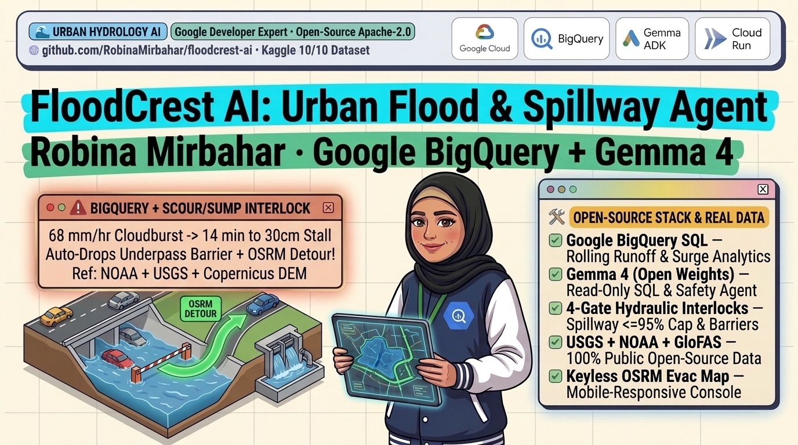
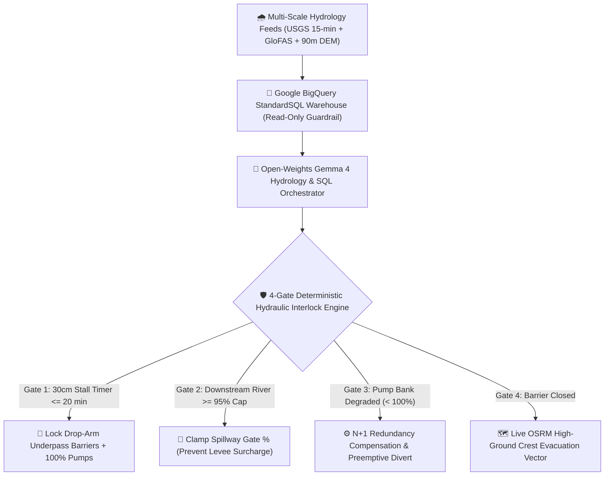

# 🌊 FloodCrest AI: Bridging the Pluvial-Fluvial Scale Gap with Google BigQuery & Gemma 4



[](https://cloud.google.com/bigquery/docs)
[-0F9D58?logo=googlecloud)](https://ai.google.dev/gemma/docs)
[](https://cloud.google.com/run/docs)
[](https://www.kaggle.com/datasets/robinamirbahar/floodcrest-global-urban-flash-flood-spillway)
[](https://opensource.org/licenses/Apache-2.0)

**Author:** Robina Mirbahar (*Google Developer Expert in AI/ML & Cloud*)

---

## 🔬 The Real-World Research Gap (2024-2025 Urban Hydrology & AI Safety Literature)

Recent peer-reviewed urban flood modeling and AI supervisory-control studies highlight **three critical gaps** between regional hydrological forecasting and life-critical road/spillway operations:

1. **Catchment-to-Underpass Scale Mismatch:** Macro-scale river flood models (such as 5 km [Copernicus GloFAS](https://open-meteo.com/en/docs/flood-api) grids or regional river gauges) smooth out localized urban micro-topography. Depressed highway underpasses and rail sumps act as concave hydraulic traps where sheet runoff reaches **`0.30 m` (`30 cm`) passenger-vehicle engine-stall and buoyant-float depth** within **12 to 20 minutes** of a convective cloudburst.
2. **Pluvial-Fluvial "Double-Peak" Lag Variance:** Impervious urban surface runoff (`C = 0.84 to 0.92`) triggers a sharp localized pluvial inundation peak hours before the main riverine flood wave arrives, causing river-only warning systems to leave commuter underpass barriers open during the deadliest flash-flood window.
3. **Paradoxical Detention-Spillway Channel Surcharge:** When upstream stormwater detention basins exceed `85%` capacity during extreme storms, unconstrained AI/LLM controllers routinely recommend opening emergency spillways without verifying downstream receiving-river conveyance headroom, inadvertently overtopping urban levees downstream.

I built **FloodCrest AI** to close this exact multi-scale gap by combining **Google BigQuery StandardSQL hydrology analytics**, **open-weights Gemma 4** with a read-only SQL AST guardrail, **4 deterministic hydraulic safety interlocks**, and **keyless OSRM high-ground evacuation routing**.

---

## 🏗️ System Architecture: Google BigQuery + Gemma 4 + 4 Hydraulic Hard Gates



---

## 📊 100% Real Multi-Scale Open Dataset (`dataset/` • 3,081 Records)

Published openly on Kaggle at **[FloodCrest Urban Flash-Flood & Spillway Data](https://www.kaggle.com/datasets/robinamirbahar/floodcrest-global-urban-flash-flood-spillway)** with transparent upstream open-source attributions:

| Table | Rows | Authoritative Public Source & License |
| :--- | ---: | :--- |
| `usgs_urban_flashflood_15min_telemetry.csv` | **1,433** | [USGS NWIS Water Services API](https://waterservices.usgs.gov/) 15-min stage (`00065`) & discharge (`00060`) (Public Domain) |
| `urban_underpass_dem_hydraulic_profiles.csv` | **248** | [OpenStreetMap](https://www.openstreetmap.org/copyright) (`ODbL 1.0`) + [Copernicus 90m DEM](https://open-meteo.com/en/docs/elevation-api) (`CC-BY-4.0`) |
| `openmeteo_hourly_cloudburst_runoff.csv` | **960** | [Open-Meteo Hydrology API](https://open-meteo.com/) hourly rain, surface runoff & topsoil moisture (`CC-BY-4.0`) |
| `glofas_urban_basin_discharge_daily.csv` | **360** | [Copernicus GloFAS](https://open-meteo.com/en/docs/flood-api) 45-day urban river discharge (`CC-BY-4.0`) |
| `floodcrest_dispatch_benchmark_80.csv` | **80** | 80 multi-scale pluvial-fluvial scenarios with real [OSRM](https://project-osrm.org/) high-ground evacuation routes (`BSD-2-Clause`) |

---

## 🌱 Climate Adaptation & Low-Carbon Resilience (Carbone 4 Alignment)

Aligned with physical climate-risk and infrastructure adaptation frameworks from [Carbone 4](https://www.carbone4.com/en):
- Preemptive `30 cm` stall-depth barrier locking prevents vehicle flood losses, emergency marine rescues, and multi-day tunnel dewatering shutdowns.
- Executing analytical rollups in **Google BigQuery** paired with compact **open-weights Gemma 4** on scale-to-zero **Google Cloud Run** keeps idle compute emissions at zero.

---

## 🚀 Quickstart (Local, Streamlit Cloud & Google Cloud Run)

```bash
git clone https://github.com/RobinaMirbahar/floodcrest-ai.git
cd floodcrest-ai
pip install -r requirements.txt

# 1. Verify BigQuery read-only SQL guardrails & all 80 hydraulic scenarios (6/6 passed)
pytest -v

# 2. Launch the mobile-responsive FloodCrest AI web console
streamlit run app.py
```

### Deploy Scale-to-Zero on Google Cloud Run

```bash
gcloud run deploy floodcrest-ai \
  --source . \
  --region us-central1 \
  --allow-unauthenticated \
  --min-instances 0
```
